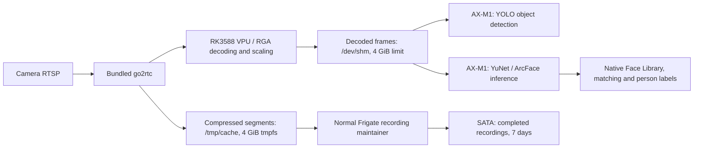

# ROCK 5 ITX Frigate / AX-M1

Implementation for ROCK 5 ITX v1.12 (24GB), AX-M1 (8GB), Armbian Debian 13,
vendor Rockchip 6.1 kernel and an existing 16TB SATA filesystem. All application
times use **Australia/Melbourne**.

**Release status: software scaffold and adapters implemented; board acceptance pending.**
The ARM64 image was built locally and passed native configuration/RAM smoke tests.
Compiled YuNet/ArcFace weights require
Pulsar2 conversion and board accuracy validation. Do not treat this repository as
a validated production appliance until [acceptance](docs/acceptance.md) passes.



The RK3588 **VPU/RGA**, rather than its NPU, handles video decoding/scaling.
AXCL explicitly selects the PCIe AX-M1 for neural inference. Face alignment and
native library matching run on the CPU. A process-shared lock serializes AXCL
execution; pending object inference gets admission before new face inference.
Faces wait at most 20ms for admission and can be skipped. An already running
native accelerator call cannot be preempted by this Python lock.

## Files

| Artifact | Purpose |
|---|---|
| `compose.yaml`, `Dockerfile` | ARM64 image pinned to the 0.18.0-rk platform digest; explicit device/runtime mounts |
| `docker/patch_upstream.py`, `overlay/` | Exact-source patches, object decoder and native face inference adapter |
| `models/manifest.json`, `tools/fetch_models.py` | Immutable model revisions and SHA256 verification |
| `tools/prepare_face.py` | Calibration packaging, Pulsar2 configs, compiled face-model registration |
| `config/`, `.env.example` | Configuration, selectable object profiles and deployment inputs |
| `tools/start.py`, `tools/preflight.py`, `deploy/` | Guarded startup and UUID-bound systemd supervision |
| `tools/health.py`, `tools/endurance.py` | RAM/cache/disk warnings and 24-hour write/swap/frame telemetry |
| `tools/backup.py`, `docs/recovery.md` | Quiesced metadata/library/model backup and rollback procedure |

## RAM and SATA behavior

Compose sets `/dev/shm` to **4GiB** and mounts a separate **4GiB** tmpfs at
`/tmp/cache`. These are independent capacity limits, allocated as used. Frigate's
frame pool is bounded with `SHM_MAX_FRAMES=20`; no playback backlog or delayed
recording flush is added. These mounts do not reserve VPU DMA/CMA memory: that
remains a BSP driver concern.

Temporary segments and clip assembly use RAM. Completed continuous recordings
still reach SATA promptly through Frigate's normal maintainer. Database,
snapshots, Face Library and model caches remain persistent. Linux file caching
uses remaining available memory normally; no dirty-page/writeback tuning is
applied. tmpfs can swap: the endurance test measures `pswpin`/`pswpout` and host
swap occupancy. Keep existing Armbian zram settings under observation; do not
silently introduce a SATA swap file for this deployment.

Health samples run every 60 seconds, write diagnostics into `/dev/shm` and publish
retained JSON to `frigate/radxa/health` when MQTT is reachable. It warns at 75%
occupancy for either RAM filesystem, 85% disk occupancy, swap usage and cache
segments older than 180 seconds. An oversized cache must not conceal a stalled
maintainer. Docker logs use three bounded 10MB files. Health warnings do not
restart a functioning recorder merely because MQTT or face recognition fails.

At eight streams averaging 8Mbps, final video alone writes approximately
**691GB/day**, or **4.84TB/seven days**, before filesystem/audio overhead.
RAM staging eliminates temporary segment writes, not durable continuous footage.
At that bitrate a full 4GiB segment cache represents roughly nine minutes of
compressed input; normal occupancy should be much lower.

## Board deployment

Use a path without spaces, e.g. `/opt/radxa-frigate`, for the project. Run board
administration steps with appropriate privileges. Preserve the current disk.

1. Validate the board's Armbian **vendor 6.1 Rockchip** BSP, matching headers,
   AXCL driver/runtime and firmware specifically for the **8GB** AX-M1. Record
   package versions and firmware hashes in the acceptance report. Obtain these
   from Radxa's matching vendor release; this project does not substitute a
   mainline kernel or install an unverified Debian 13 DKMS combination.
   Confirm `axcl-smi` shows the card and memory capacity. Required runtime paths
   are `/usr/bin/axcl` and `/usr/lib/axcl`.
2. Inspect the existing filesystem with `lsblk -f` and `blkid`. Create the mount
   directory and merge the UUID/type line from `deploy/fstab.example` into
   `/etc/fstab`. Mount it at `/srv/frigate/media`. Verify `findmnt --mountpoint
   /srv/frigate/media -o TARGET,UUID,FSTYPE,OPTIONS`. Do **not** run `mkfs`.
   The supplied service assumes this exact mount path; changing it requires
   changing `BindsTo`, `After` and `RequiresMountsFor` too.
3. Create `/srv/frigate/config`. Install Docker Engine/Compose for ARM64 and
   host Python with PyYAML (`python3-yaml` on Debian). For development tests,
   use a virtual environment with `requirements-test.txt`.
4. Copy `.env.example` to `.env`, fill every deployment placeholder and set
   `chmod 600 .env`. `.env` values are literal: do not use shell expansion or
   inline comments. `tools/start.py` percent-encodes URI credentials without
   changing the raw RTSP authentication password. Never `source .env`.
5. Generate the persistent config and download the baseline model:

   ```sh
   python3 tools/render_config.py --output /srv/frigate/config/config.yml
   python3 tools/fetch_models.py --profiles yolov9 --face-sources --config-dir /srv/frigate/config
   ```

   For a TLS broker, put its trusted CA at `/srv/frigate/config/mqtt-ca.crt`, set
   `FRIGATE_MQTT_TLS=true` and the broker port in `.env`, and render with
   `--mqtt-tls --mqtt-port 8883` (use the actual broker port). Client certificate
   authentication can be configured through Frigate's native MQTT settings;
   adapt Compose/health publishing if using mTLS instead of supplied user/password.
6. Complete [face model conversion](docs/models.md), registering both compiled
   models in `models/artifacts/manifest.json`. Strict preflight rejects an enabled
   face backend with missing models. To commission recording/object detection
   first, explicitly set `face_recognition.enabled: false` in the generated config;
   turn it back on and restart after conversion. This is a commissioning step,
   not completion of the face acceptance criteria.
7. Build and check on the board:

   ```sh
   python3 tools/start.py build
   python3 tools/start.py config
   sudo python3 tools/start.py check
   ```

   For cross-building on a Linux Docker build host, use
   `docker buildx build --platform linux/arm64 --load -t radxa-frigate:0.18.0-radxa.1 .`.
   Source patches fail closed if the pinned image files differ. The runtime wheel
   is already present in the pinned base image. Read-only host AXCL libraries must
   match its API; board tests verify that binding.
8. Install the systemd template, replacing `@PROJECT_DIR@`:

   ```sh
   sed 's|@PROJECT_DIR@|/opt/radxa-frigate|g' deploy/frigate.service.in | sudo tee /etc/systemd/system/frigate.service >/dev/null
   sudo systemctl daemon-reload
   sudo systemctl enable --now frigate.service
   ```

   Use the service for normal starts/stops. It binds container lifetime to the
   media mount and repeats preflight on service restarts. Docker's `on-failure`
   policy handles process crashes without bypassing the guard after a host reboot.
   `tools/start.py up` is available for supervised commissioning but does not
   supply systemd's mount-disappearance protection. Do not use unguarded
   `docker compose up` as the boot service.

## Camera and access configuration

The initial camera uses Wyze Cam v3 direct RTSP `/live`. It requires an existing
working RTSP-capable camera firmware/configuration. Verify that endpoint before
deployment; the Wyze cloud stream is not assumed to be an RTSP source.

The main stream is restreamed through bundled go2rtc, decoded/scaled to
1280×720 at 5 detection FPS, and copied at original resolution for recording.
No camera-side resolution change is forced. Add up to eight named cameras by
copying the go2rtc stream and camera blocks, supplying unique input URLs or
additional `FRIGATE_*` environment values in Compose. Do not point eight
production entries at one camera. The same-stream eight-entry method is useful
only as an initial processing-load test before real cameras are available.

Generate that rehearsal configuration with `tools/render_config.py
--test-cameras 8 --output /srv/frigate/config/config.load-test.yml`. It shares
one upstream go2rtc connection, avoiding eight direct connections to the Wyze.
Review and install it for the rehearsal, then restore the one-camera config.

For dual-stream cameras, give the substream its own go2rtc name, use it only for
the `detect` role, and retain `record` on the original main stream. Set each
dashboard `live.streams` default to its lower-resolution stream. Prefer H.264 and
approximately one-second camera keyframe intervals when supported; validate the
camera's actual settings. Add a reachable board LAN/VPN address to
`go2rtc.webrtc.candidates`, e.g. `192.0.2.10:8555` (replace that example address).

Access authenticated HTTPS on **8971**. Obtain the initial admin password from
`docker logs radxa-frigate` and change it. Frigate's generated self-signed TLS
certificate will need browser trust or a properly configured reverse proxy.
RTSP is **8554** with the configured restream authentication; WebRTC is **8555
TCP/UDP**. Port 5000 stays internal. `BIND_IP` controls the host interface.
Timezone defaults to Australia/Melbourne in both image and container; keep the
board clock synchronized, and use that zone in client presentation as desired.

Native Face Library enrollment, known/unknown matching and recognized person
`sub_label` publication remain Frigate's own paths. Existing ONNX library
embeddings are rebuilt from persistent enrollment samples using the compiled
ArcFace model. Verify enrolled identities again after changing model weights or
quantization; threshold 0.9 is an initial setting, not an accuracy guarantee.

## Validation

```sh
python3 -m unittest discover -s tests -v
```

With `tools/research.py` source fixtures present, the suite additionally applies
the patches to verified upstream sources. It covers numerical decoder behavior,
metadata/checksum/provider contracts, accelerator contention, face exception
containment, URL credential escaping and storage UUID rejection. It uses mocked
AXCL sessions; it does not establish model accuracy or hardware compatibility.

Follow [the hardware acceptance runbook](docs/acceptance.md) before accepting an
eight-camera deployment. [Recovery instructions](docs/recovery.md) cover backup,
upgrade rollback, missing storage, faults and loss of unfinished RAM segments.
The [software validation report](docs/software-validation.md) records the built
image identity and completed local checks.

Sources: [Radxa AX-M1 Frigate](https://docs.radxa.com/en/aicore/ax-m1/frigate-axera),
[Radxa Rockchip Frigate](https://docs.radxa.com/en/rock5/rock5b/app-development/frigate-rk),
[Frigate 0.18.0 source](https://github.com/blakeblackshear/frigate/tree/v0.18.0),
[AXERA YOLO26 models](https://huggingface.co/AXERA-TECH/yolo26),
[AXCL YOLO26 reference](https://github.com/AXERA-TECH/axcl-samples/blob/main/examples/axcl/ax_yolo26_steps.cc).
